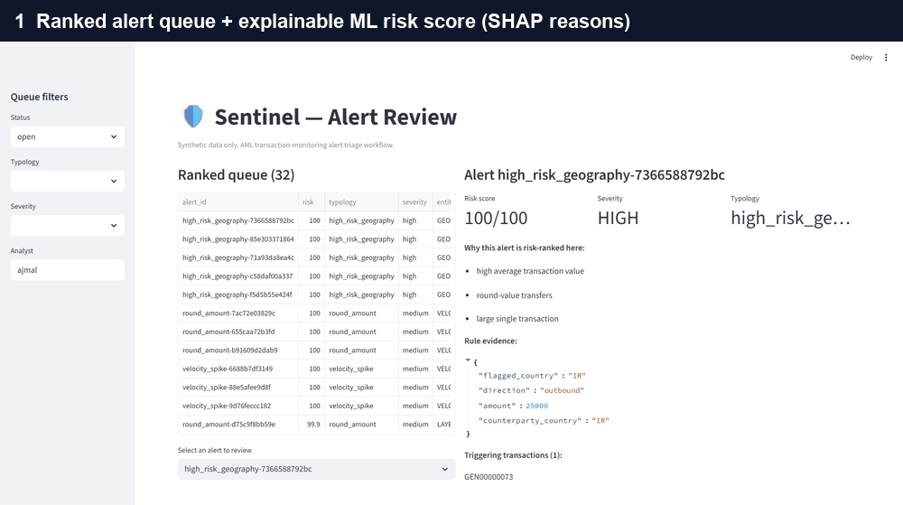
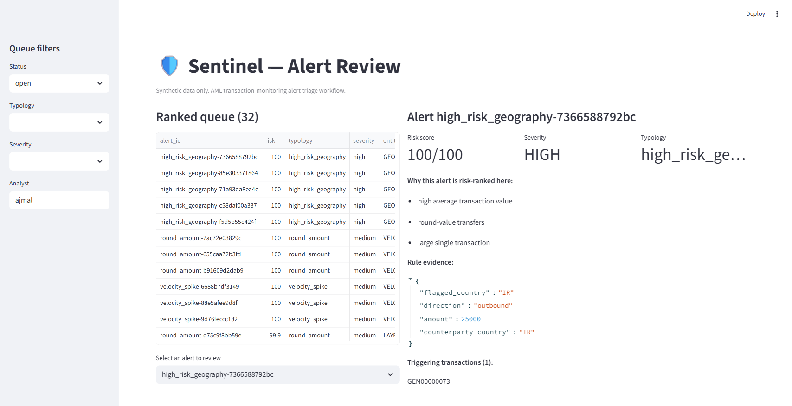
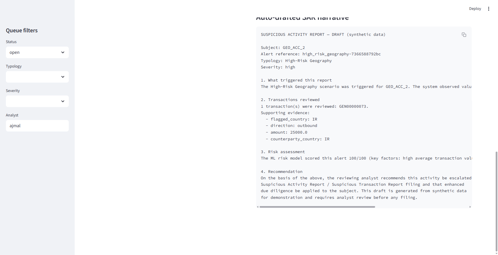
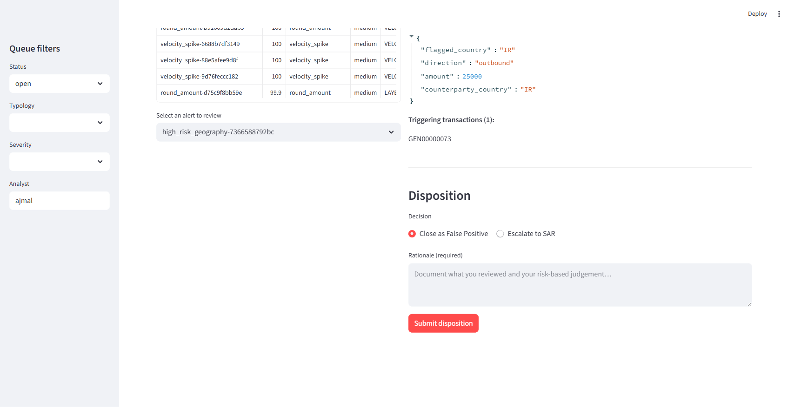
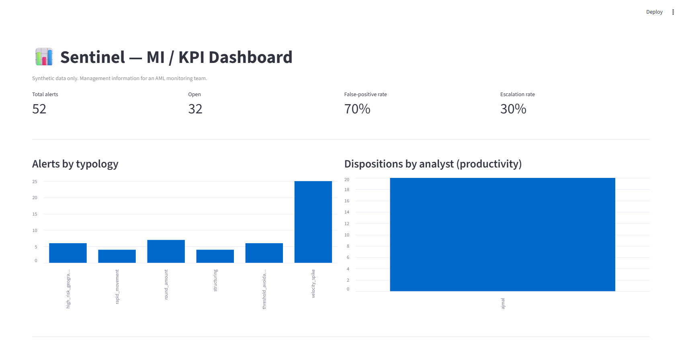

# Sentinel AML — Transaction Monitoring & Alert Triage System

An end-to-end, **portfolio-grade Anti-Money Laundering (AML) transaction-monitoring
system**. It ingests synthetic banking transactions, runs a typology-based rules
engine that mirrors real AML detection scenarios, generates alerts, ranks them with
an explainable ML risk model that reduces false-positive review volume, and presents
everything in an **analyst alert-review dashboard** where a user triages each alert,
records a disposition, and auto-drafts a **Suspicious Activity Report (SAR)** narrative.
A secondary **MI / KPI dashboard** gives the manager-level view.

> ### Synthetic data only — by design
> Sentinel **never** uses real customer or transaction data. It runs on the
> public **SAML-D** synthetic dataset (typology-labelled) and a documented,
> reproducible synthetic generator. Handling data responsibly is where AML
> compliance starts, so this is a deliberate, stated design decision — not an
> afterthought. See [`data/README.md`](data/README.md).

---

## Demo



*Ranked queue → explainable ML risk score → analyst disposition with mandatory rationale → auto-drafted SAR narrative → manager MI/KPI view.*

| Analyst review (queue + SHAP explanation) | Auto-drafted SAR narrative |
|---|---|
|  |  |
| **Disposition (mandatory rationale)** | **MI / KPI dashboard** |
|  |  |

---

## What it does (the analyst's workflow, in code)

1. **Ingest & validate** synthetic transactions into typed Pydantic models.
2. **Detect** money-laundering typologies with a config-driven **rules engine**.
3. **Rank** the alert queue with an **explainable ML risk model** (gradient
   boosting + SHAP), surfacing *why* each alert scores as it does.
4. **Triage** each alert in the analyst dashboard → record a disposition with a
   **mandatory rationale** → escalations auto-draft a **SAR narrative**.
5. **Report** team metrics on the **MI/KPI dashboard**, and persist every action
   to an **immutable audit trail**.

## Typologies detected (rules engine)

Structuring / smurfing · rapid movement (pass-through) · round-amount layering ·
threshold avoidance · high-risk geography · velocity spike · (optional) network /
mule ring. Each is a pure, config-tunable function with **golden-case unit tests**.
Thresholds live in [`config/rules.yaml`](config/rules.yaml) so they tune like a real
analyst's scenario parameters.

## Measured result (reproducible, synthetic data)

On a held-out synthetic test set (66 true-positive vs. 39 false-positive alerts), at
a risk threshold preserving a 95% recall target, the ML layer:

- **preserved 95.5% recall** on labelled laundering alerts, while
- **deprioritising 97.4% of false-positive alerts** (review-volume cut of ~39%).

Every figure is reproducible — regenerate it with:

```bash
python -m sentinel.scoring.evaluate   # writes artifacts/metrics.json
```

These are honest numbers from this repo's output on **synthetic** data; they are
illustrative of the rules-vs-rules+ML trade-off, not a production benchmark.

## Architecture

```
synthetic txns → ingestion (Pydantic) → rules engine (typologies) →
   ML risk scoring (GBM + SHAP) → case store (SQLite + audit trail) →
      ├─ Analyst dashboard (review → disposition → SAR draft)
      └─ MI/KPI dashboard (volumes, FP rate, productivity)
```

- **Backend:** FastAPI + Pydantic v2 · **ML:** scikit-learn + SHAP
- **Storage:** SQLite (default), Postgres optional via `SENTINEL_DB_URL`
- **Frontend:** Streamlit (analyst + MI dashboards) · **Infra:** Docker Compose

## Quick start

```bash
pip install -e ".[dev]"          # or: make setup

python -m sentinel.cli run-rules # Phase 1: ingest → typed alerts
python -m sentinel.cli train     # train the risk model artifact
python -m sentinel.cli seed      # persist scored alerts to the case store

uvicorn sentinel.api.main:app --port 8000          # API
streamlit run dashboards/analyst_app.py            # analyst dashboard (8501)
streamlit run dashboards/mi_app.py                 # MI dashboard (8502)
```

Or the whole stack in one command:

```bash
docker compose up --build        # API :8000 · analyst :8501 · MI :8502
```

By default Sentinel uses the synthetic generator. To use SAML-D, place the CSV at
`data/raw/SAML-D.csv` (see [`data/README.md`](data/README.md)).

## Testing & quality

```bash
pytest          # golden-case rule tests, case store, API, scoring
ruff check src tests
```

## Project layout

| Path | Purpose |
|------|---------|
| `src/sentinel/models/` | Pydantic domain models |
| `src/sentinel/ingestion/` | load + normalise + validate transactions |
| `src/sentinel/generator/` | reproducible synthetic generator (incl. hard negatives) |
| `src/sentinel/rules/` | one module per typology + runner |
| `src/sentinel/scoring/` | features, GBM model, SHAP, honest evaluation |
| `src/sentinel/casestore/` | SQLite persistence + immutable audit trail |
| `src/sentinel/sar/` | template-first SAR narrative generator |
| `src/sentinel/api/` | FastAPI app |
| `dashboards/` | Streamlit analyst + MI apps |
| `tests/` | golden-case + integration tests |

## Honesty guardrails

- Every metric here is **reproducible from this repo's output** on synthetic data.
- No real customer/bank data is ever used or implied.
- This is a learning project that mirrors the real TM workflow — not a certified
  production system.
